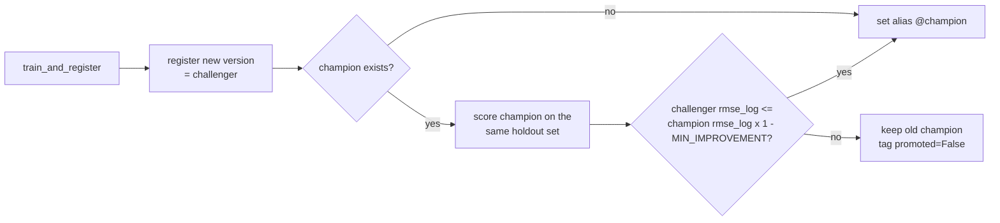
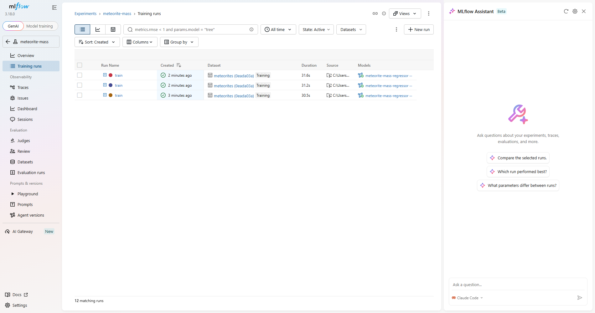
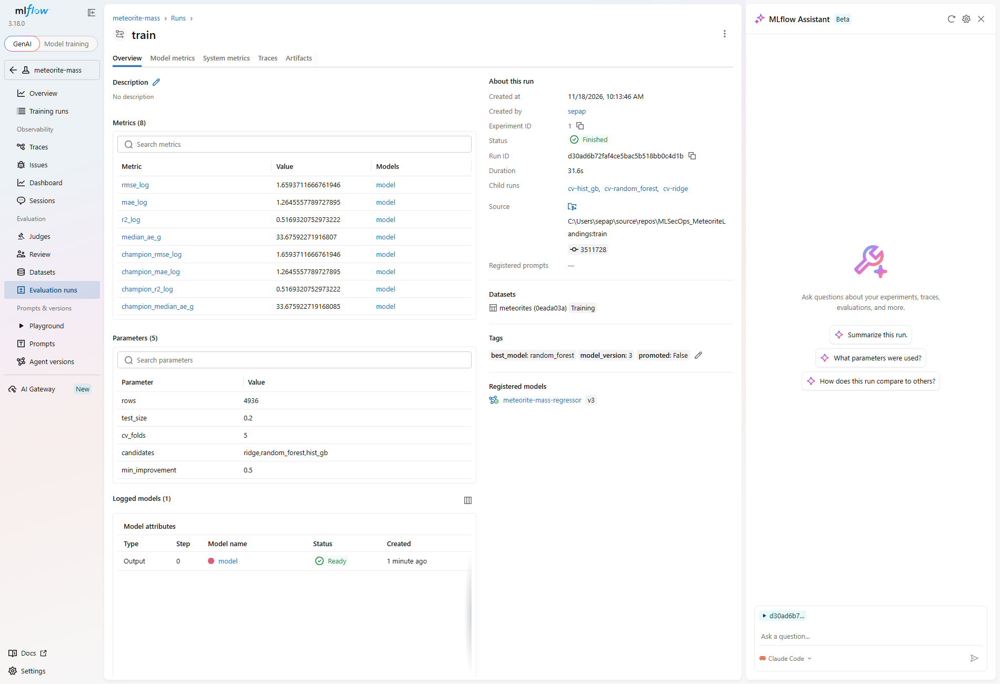
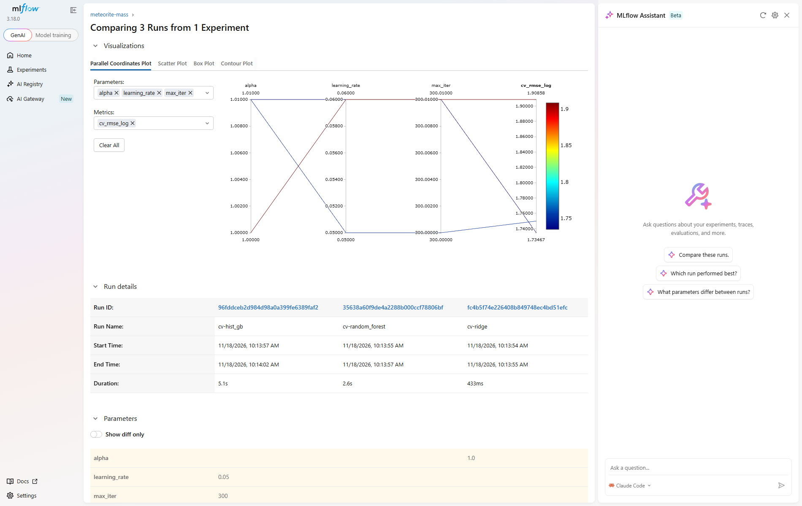
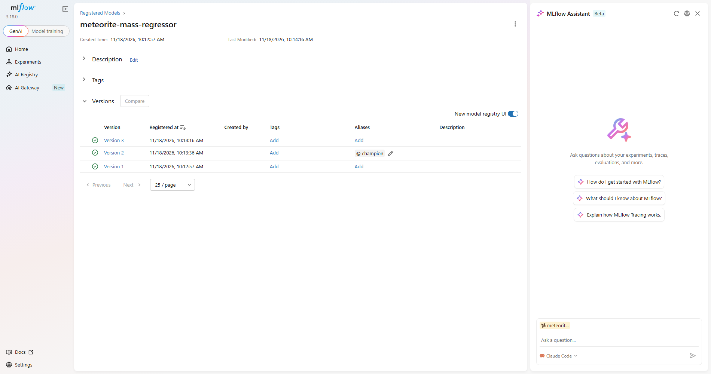
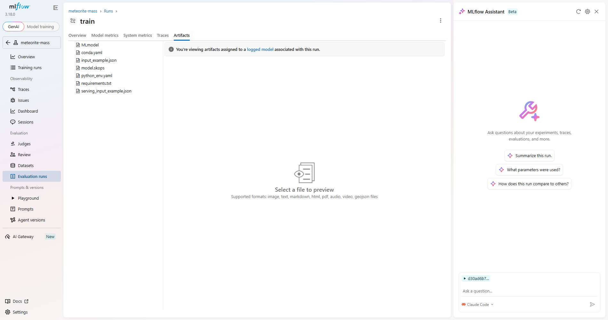

# MLSecOps_MeteoriteLandings

Regression model predicting the mass of a meteorite from the NASA
[Meteorite Landings](https://www.kaggle.com/datasets/nasa/meteorite-landings) dataset,
wrapped in an MLOps toolchain (DVC, MLflow, REST API, Docker, Evidently, Streamlit, Airflow).

## Local development

Requirements: Python 3.13, Git.

```powershell
py -3.13 -m venv .venv
.\.venv\Scripts\Activate.ps1
python -m pip install --upgrade pip
pip install -r requirements-dev.txt
pip install -e .
pre-commit install --hook-type pre-commit --hook-type commit-msg --hook-type pre-push
```

### Quality checks

| Check | Command | Rule |
|-------|---------|------|
| PEP8 | `flake8 src tests` | max line length 120 |
| Types | `pyright` | strict mode, `src/` only, 0 errors |
| Tests + coverage | `pytest` | coverage >= 95% over `src/` and `tests/` |
| All hooks | `pre-commit run --all-files` | runs on every commit / push |

## Team conventions

- **Commits:** [Conventional Commits](https://www.conventionalcommits.org/)
  (`feat:`, `fix:`, `test:`, `docs:`, `chore:`, `build:`, `ci:`, `refactor:`, `style:`),
  enforced by the `commit-msg` hook.
- **Branches:** `feature/<topic>`, `fix/<topic>`, `docs/<topic>`; `main` only changes through
  reviewed pull requests merged with a merge commit (history of feature branches is kept).
- **Code layout:** all business logic lives in `src/meteorite/`; Streamlit and Airflow code is a thin layer.
- **Dependencies:** exact `==` versions in `requirements.txt` (runtime) and `requirements-dev.txt` (tooling).

## Interface contract (ML core -> REST API / monitoring)

The REST API (`src/meteorite/api/`) and the monitoring layer only use these public objects:

| Module | Object | Used by |
|--------|--------|---------|
| `meteorite.schemas` | `MeteoriteFeatures` (pydantic input model), `FEATURE_COLUMNS`, `TARGET_COLUMN` | API request validation, Evidently column mapping |
| `meteorite.config` | `Settings.from_env()` | everything that needs paths / MLflow URI |
| `meteorite.training` | `train_and_register(settings=None, candidates=None) -> TrainResult` | `/train` endpoint, Airflow DAG |
| `meteorite.inference` | `load_champion(tracking_uri=None)`, `predict(model, records) -> list[float]` | `/predict` endpoint |

Environment variables: `DATA_PATH`, `MLFLOW_TRACKING_URI`, `MLFLOW_EXPERIMENT_NAME`, `MIN_IMPROVEMENT`.

## Data versioning (DVC)

- Raw data: `data/raw/Meteorite_Landings.csv` - the NASA Meteorite Landings export (45,716 rows,
  the same file that is mirrored on Kaggle), tracked by DVC (`.dvc` pointer file in git, content in the remote).
- Sample: `data/processed/meteorites_sample.csv` - 5,000 rows drawn by the DVC `sample` stage
  (`dvc.yaml`), size and seed live in `params.yaml`.
- Remote: DagsHub (`https://dagshub.com/speter9701/MLSecOps_MeteoriteLandings.dvc`).

```powershell
# one-time: credentials stay local (.dvc/config.local is git-ignored)
dvc remote modify origin --local user <dagshub-username>
dvc remote modify origin --local password <dagshub-token>

dvc pull      # download the data
dvc repro     # re-run the sample stage after changing params.yaml or src/meteorite/data.py
dvc push      # upload new data versions
```

## Preprocessing

Implemented in `src/meteorite/preprocessing.py` (`clean_data`, `add_geo_features`, `build_preprocessor`).

| Problem in the raw data | Handling |
|-------------------------|----------|
| Target column called `mass (g)` | renamed to `mass` |
| Missing (131) or zero mass (19) | row dropped - the target must be known and positive |
| Year as number or date string, impossible values (e.g. 2101) | parsed to a number, outside 800-2016 set to missing, later median-imputed |
| `(0, 0)` coordinates (6,214 rows) mean "unknown location" | set to missing, later median-imputed |
| Longitude outside +-180 (e.g. 354) | set to missing |
| `name`, `id`, `GeoLocation` | dropped (identifiers / redundant with `reclat`, `reclong`) |
| 466 meteorite classes, many rare | one-hot encoding, classes seen fewer than 10 times grouped as "infrequent" |
| Hypothesis: Antarctica matters | engineered features `is_antarctica` (latitude < -60) and `abs_lat` |

The sklearn preprocessor (feature engineering, imputation, scaling, encoding) is part of the model pipeline,
so training and the `/predict` endpoint always apply exactly the same transformation.

## Model

- Task: regression of `mass` (grams) from `recclass`, `nametype`, `fall`, `year`, `reclat`, `reclong`.
- The target spans 0.01 g - 60 t, so every model is a `TransformedTargetRegressor`: it is trained on
  `log1p(mass)` and predicts grams through `expm1`.
- Candidates (`src/meteorite/model.py`): `Ridge`, `RandomForestRegressor`, `HistGradientBoostingRegressor`,
  each behind the same preprocessing pipeline.
- Metrics (`src/meteorite/evaluation.py`): `rmse_log` (model selection and promotion metric), `mae_log`,
  `r2_log`, `median_ae_g`. Model quality itself is not a goal of the project; keeping it from degrading
  automatically is (see *Automatic promotion*).

## Experiment tracking (MLflow)

`meteorite.training.train_and_register()` (`src/meteorite/training.py`) creates one parent run per training:

- **nested runs** `cv-<model>`: one per candidate, with its hyperparameters and the K-fold `cv_rmse_log`;
- **parent run** `train`: dataset input (`mlflow.log_input`), split / CV parameters, holdout metrics,
  `best_model` tag and the fitted pipeline as an MLflow model with signature and input example.

The model is serialized with **skops** instead of pickle, so loading a model cannot execute arbitrary code.
Only the types listed in `SKOPS_TRUSTED_TYPES` are allowed; a test checks that every candidate model
serializes with allow-listed types only.

```powershell
$env:MLFLOW_TRACKING_URI = "sqlite:///mlflow.db"
mlflow run . -e train --env-manager local --experiment-name meteorite-mass   # or: python -m meteorite.training
mlflow ui --backend-store-uri sqlite:///mlflow.db                             # http://127.0.0.1:5000
```

## Automatic promotion (champion / challenger)

Model quality is protected automatically by the MLflow Model Registry (`src/meteorite/registry.py`):



- Every training registers a new version of `meteorite-mass-regressor`.
- The challenger gets the `@champion` alias only if it is **not worse** than the current champion
  on the same holdout data (`MIN_IMPROVEMENT` env var = required relative gain, default 0).
- The REST API always serves `models:/meteorite-mass-regressor@champion` (`meteorite.inference.load_champion`),
  so a worse model never reaches production; retraining (API `/train` or the Airflow DAG) can only keep
  or improve the served model quality.
- The champion's holdout metrics are logged next to the challenger's as `champion_*` metrics, with
  `promoted` and `model_version` tags, so every decision is traceable in the MLflow UI.

### Screenshots (ML core)

Three real trainings on the 5,000-row sample: version 1 became champion, version 2 (equal score) was
promoted, version 3 was trained with `MIN_IMPROVEMENT=0.5` and therefore **not** promoted.

| View | Screenshot |
|------|-----------|
| Experiment: parent `train` runs (nested `cv-*` runs collapsed) |  |
| Parent run: metrics incl. `champion_*`, params, dataset, tags `promoted=False`, registered `v3` |  |
| Candidate comparison (nested CV runs, `cv_rmse_log`) |  |
| Model registry: 3 versions, `@champion` on version 2 |  |
| Logged model artifacts (`model.skops`, signature, input example) |  |

## REST API

FastAPI application in `src/meteorite/api/` (thin layer: business logic stays in `src/meteorite/`).

### Run locally

```powershell
$env:MLFLOW_TRACKING_URI = "sqlite:///mlflow.db"
python -m uvicorn meteorite.api.app:app --reload     # http://127.0.0.1:8000/docs (Swagger UI)
```

| Method | Path | Description |
|--------|------|-------------|
| `GET` | `/health` | liveness probe, returns `{"status": "ok"}` |
| `POST` | `/predict` | predicted mass (grams) for 1-1000 records with the `@champion` model |
| `POST` | `/train` | retrain + register a new version, promote it only if it is not worse than the champion |

### `POST /predict`

The API serves the model version that holds the `@champion` alias. `meteorite.model_store.ModelStore` loads it
lazily on the first request and keeps it in memory; the response tells which registry version answered.
Each record uses the `MeteoriteFeatures` schema of the ML core (only `recclass` is required).

```powershell
$body = @{ records = @(
    @{ recclass = "L6"; nametype = "Valid"; fall = "Found"; year = 1998; reclat = -76.7; reclong = 159.4 },
    @{ recclass = "H5" }
) } | ConvertTo-Json -Depth 3
Invoke-RestMethod http://127.0.0.1:8000/predict -Method Post -ContentType "application/json" -Body $body
```

Example response (the values depend on the current champion):

```json
{"model_version": "2", "predictions": [37.9, 214.6]}
```

| Status | When |
|--------|------|
| 200 | predictions returned, in the order of `records` |
| 422 | invalid input: no / more than 1000 records, missing `recclass`, unknown field, value out of range |
| 503 | no champion model in the registry yet (`"No champion model yet, call /train first"`) |

### `POST /train`

Calls `meteorite.training.train_and_register()` with `Settings.from_env()` (`DATA_PATH`, `MLFLOW_TRACKING_URI`,
`MLFLOW_EXPERIMENT_NAME`, `MIN_IMPROVEMENT`), so the API, the CLI and the Airflow DAG train exactly the same way.
If the new version was promoted, the API reloads the `@champion` model, and the next `/predict` already uses it.

- The body is optional: `{"min_improvement": 0.02}` overrides `MIN_IMPROVEMENT` for this run only
  (`0 <= min_improvement < 1`, relative RMSE gain the challenger needs).
- The call is **synchronous** and takes about 45 s on the 5,000-row sample: the client gets the final result
  (no job id to poll). FastAPI runs it in its thread pool, so `/predict` keeps answering in the meantime with the
  previous champion. Use a client timeout of at least 2 minutes.

```powershell
Invoke-RestMethod http://127.0.0.1:8000/train -Method Post -TimeoutSec 300
Invoke-RestMethod http://127.0.0.1:8000/train -Method Post -TimeoutSec 300 -ContentType "application/json" `
    -Body '{"min_improvement": 0.5}'
```

Example response (`dataclasses.asdict` of `TrainResult`; values depend on the data and the current champion):

```json
{
  "run_id": "5f0c3d...",
  "best_model": "random_forest",
  "model_version": "4",
  "metrics": {"rmse_log": 1.71, "mae_log": 1.22, "r2_log": 0.43, "median_ae_g": 61.0},
  "champion_metrics": {"rmse_log": 1.71, "mae_log": 1.22, "r2_log": 0.43, "median_ae_g": 61.0},
  "promoted": true
}
```

| Status | When |
|--------|------|
| 200 | training finished; `promoted` tells whether the new version became `@champion` |
| 422 | invalid body: `min_improvement` outside `[0, 1)` or unknown field |
